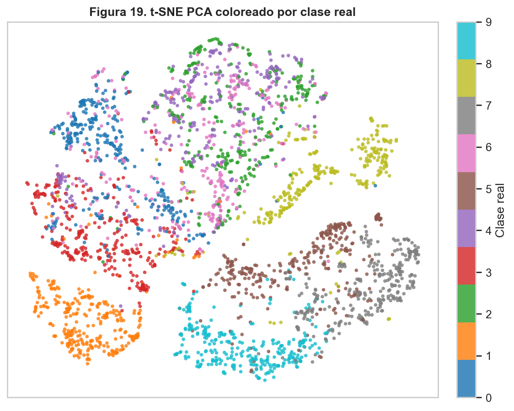
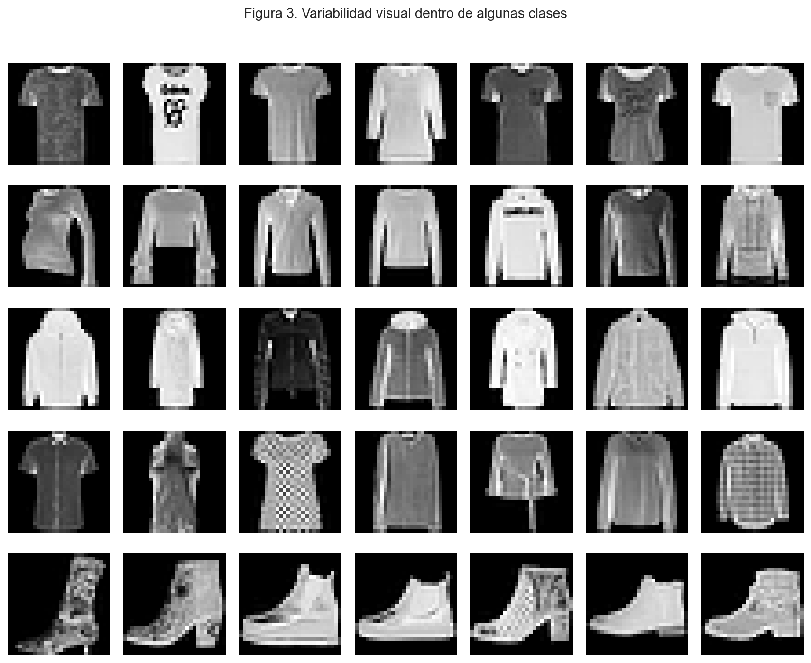
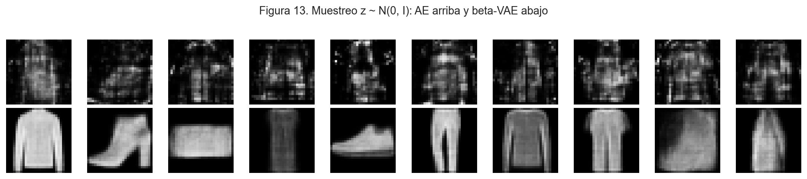
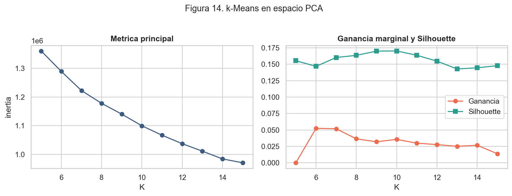
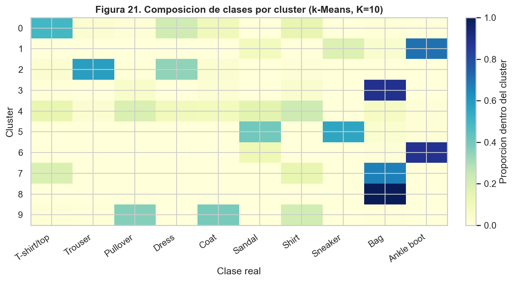

# Fashion-MNIST: Unsupervised Learning
### Representaciones y agrupamiento de imágenes de ropa

¿Qué estructura aparece en miles de imágenes de ropa si nunca se usan las etiquetas para entrenar? En este trabajo comparo distintas formas de comprimir las imágenes (PCA, autoencoders, β-VAE) y de agruparlas (k-Means, GMM), y uso las etiquetas solo al final, para evaluar.

**Tomás González** · Machine Learning, UdeSA · junio de 2026

[Informe](Gonzalez_Tomas_Informe_TP4.pdf) · [Notebook](Gonzalez_Tomas_Notebook_TP4.ipynb)

## Recorrido

### 1. Conocer los datos

25.000 imágenes de 28 × 28 píxeles, balanceadas entre diez clases. La variabilidad dentro de una misma clase es grande, y varias clases se parecen entre sí (remeras, buzos, camisas y abrigos).

### 2. Comprimir las imágenes

Implementé PCA con NumPy y entrené un autoencoder y un β-VAE con PyTorch. Las tres técnicas reducen cada imagen a unas pocas dimensiones; la comparación de las reconstrucciones muestra qué conserva cada una.

A diferencia del autoencoder, el β-VAE permite generar prendas reconocibles muestreando su espacio latente (arriba, autoencoder; abajo, β-VAE):

### 3. Agrupar sin etiquetas

Sobre esas representaciones probé k-Means y un GMM diagonal, ambos implementados con NumPy. La configuración elegida fue **k-Means sobre PCA con K = 10**, con 135 componentes que retienen el 90 % de la varianza.

### 4. Comparar con las clases reales

Recién acá entran las etiquetas. Los bolsos y las botas forman grupos claros, zapatillas y sandalias comparten un cluster, y las prendas de la parte de arriba (buzos, abrigos, camisas) se mezclan entre sí, igual que en la proyección t-SNE.

Silhouette de 0,1702 y pureza externa ponderada de 0,5207. La pureza mide cuánto coincide cada cluster con una clase; no equivale a la accuracy de un clasificador.

## Ejecutar

Descargar el [CSV desde Releases](https://github.com/TomaasGonzalezzz/i302-tp4-aprendizaje-no-supervisado/releases/tag/tp4-dataset-2026) y colocarlo en **data/fashion_mnist_subset.csv**. Con un entorno virtual activo:

~~~sh
python -m pip install -r requirements.txt
python -m notebook Gonzalez_Tomas_Notebook_TP4.ipynb
~~~

El repositorio incluye las 21 figuras y las tablas de resultados para consultar los experimentos sin reentrenar.

[Entorno, archivos y verificaciones](DOCUMENTACION.md)
