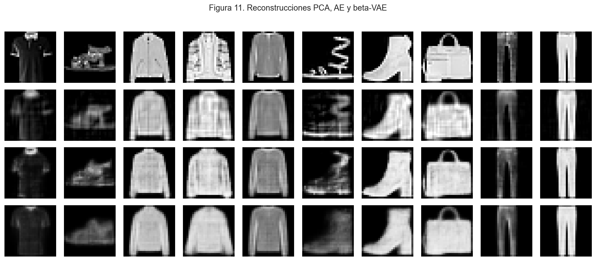

# Fashion-MNIST: Unsupervised Learning

Comparación de representaciones y agrupamientos de imágenes de ropa mediante **PCA, autoencoders, β-VAE, k-Means, GMM y t-SNE**. El objetivo es estudiar qué estructura puede recuperarse sin usar las etiquetas para ajustar los modelos.

**Tomás González** · Machine Learning, UdeSA · junio de 2026.

[Informe](Gonzalez_Tomas_Informe_TP4.pdf) · [Notebook](Gonzalez_Tomas_Notebook_TP4.ipynb)

## Representación y agrupamiento

El dataset tiene 25.000 imágenes de 28 × 28 píxeles, balanceadas entre diez clases. Se reservan 20.000 para entrenamiento y 5.000 para evaluación; el clustering se estudia sobre una muestra estratificada de 3.000.

Implementé PCA, k-Means, GMM diagonal y t-SNE con NumPy, y las redes con PyTorch. Las etiquetas se usan para muestreo, inspección y evaluación externa.

La configuración seleccionada en la entrega es **k-Means sobre PCA, con K = 10**:

- 135 componentes de PCA retienen al menos el 90 % de la varianza.
- Silhouette: **0,1702**.
- Pureza externa ponderada: **0,5207**.

La pureza no equivale a accuracy supervisada. Son resultados conservados del informe y sus tablas.

## Datos y ejecución

Descargar el [CSV desde Releases](https://github.com/TomaasGonzalezzz/i302-tp4-aprendizaje-no-supervisado/releases/tag/tp4-dataset-2026) y colocarlo en **data/fashion_mnist_subset.csv**.

Con un entorno virtual activo, desde la raíz:

~~~sh
python -m pip install -r requirements.txt
python -m notebook Gonzalez_Tomas_Notebook_TP4.ipynb
~~~

El notebook registra Python 3.14.3; las versiones de bibliotecas no quedaron fijadas. La instalación completa de PyTorch no fue verificada al preparar el portfolio.

El repositorio incluye 21 figuras y siete CSV para consultar los experimentos. Reejecutar el notebook entrena las redes y recalcula clustering y t-SNE; no hay checkpoints o embeddings guardados que sustituyan ese proceso.

[Entorno, archivos y verificaciones](DOCUMENTACION.md).
